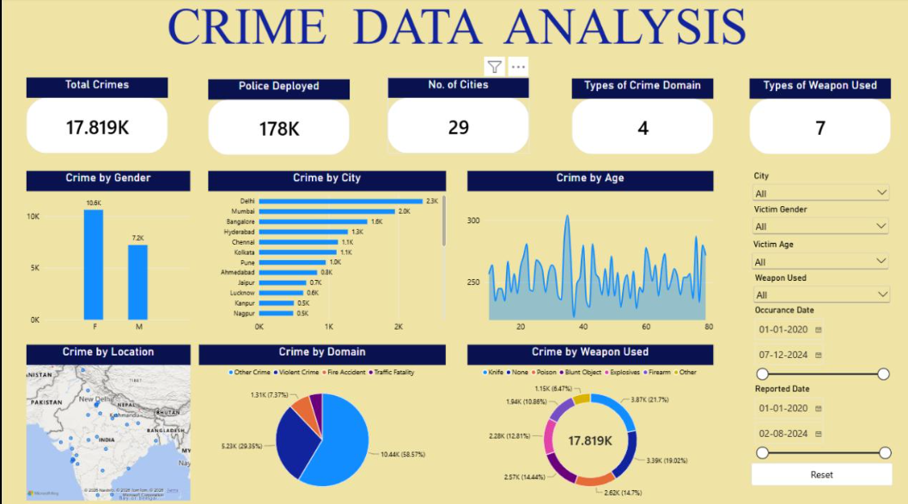

# Crime Data Analysis 📊 

## 📌 Aim

The **Crime Data Analysis Dashboard** is an interactive, single-page Power BI report designed to analyze crime-related data across cities, victim demographics, crime domains, geographical locations, and weapon categories.

The dashboard transforms crime data into meaningful visual insights, helping users explore patterns, compare city-level statistics, and understand the distribution of recorded incidents through interactive filters and visualizations.

## 🎯 Objectives

- Analyze recorded crimes across different cities.
- Compare crime records by victim gender and age.
- Identify the most frequently represented crime domains.
- Analyze the distribution of weapon categories.
- Visualize crime locations geographically.
- Enable interactive filtering by city, demographics, weapon type, and dates.
- Present key metrics in a clear and accessible dashboard.

## 🛠️ Tools & Technologies

- **Microsoft Power BI** – Dashboard development and data visualization
- **Power Query** – Data transformation (if used)
- **DAX** – Measures and calculations (if used)

## 📈 Dashboard KPIs

| KPI | Value | Description |
|---|---:|---|
| Total Crimes | 17.819K | Total crime records displayed |
| Police Deployed | 178K | Police deployment metric displayed |
| Number of Cities | 29 | Cities represented in the dashboard |
| Crime Domains | 4 | Crime domain categories |
| Weapon Categories | 7 | Weapon categories represented |

*Note: KPI values are based on the dashboard screenshot and may change when filters are applied.*

## 📊 Dashboard Visualizations

### 1. Crime by Gender
A column chart comparing recorded crime counts by victim gender.

### 2. Crime by City
A horizontal bar chart ranking cities according to recorded crime counts.

### 3. Crime by Age
A line and area chart showing variations in the displayed crime measure across victim ages.

### 4. Crime by Location
A geographical map displaying crime-related locations and supporting spatial analysis.

### 5. Crime by Domain
A pie chart showing the distribution of recorded incidents across four domains:

- Other Crime
- Violent Crime
- Fire Accident
- Traffic Fatality

### 6. Crime by Weapon Used
A doughnut chart comparing seven weapon categories:

- Knife
- None
- Poison
- Blunt Object
- Explosives
- Firearm
- Other

## 🔍 Interactive Features

The dashboard includes the following slicers and controls:

- **City** – Explore records for selected cities.
- **Victim Gender** – Filter records by gender.
- **Victim Age** – Filter records by age.
- **Weapon Used** – Analyze selected weapon categories.
- **Occurrence Date** – Filter by incident occurrence dates.
- **Reported Date** – Filter by reporting dates.
- **Reset Button** – Return to the default filter selection.

These interactive features allow users to explore specific subsets of the data and compare patterns across different dimensions.

## 💡 Key Insights

Based on the displayed dashboard:

- **Delhi** has the highest recorded crime count among the displayed cities, at approximately 2.3K.
- **Other Crime** is the largest crime-domain category, representing approximately 58.57% of the displayed records.
- **Knife** is the largest displayed weapon category, accounting for approximately 21.7%.
- The dashboard shows a higher recorded count for female victims than male victims.
- The geographical map enables users to explore the distribution of recorded crime locations.
- Occurrence-date and reported-date filters allow users to examine records across different time periods.

*These findings describe the displayed dataset and should not be interpreted as population-adjusted crime rates or proof of causation.*

## 📷 Dashboard Preview

## 🧠 Skills Demonstrated

- Data analysis and interpretation
- KPI reporting
- Data visualization
- Comparative and demographic analysis
- Geographical data visualization
- Interactive dashboard design
- Business insight communication
- Power BI report development

## 🚀 How to Use

1. Clone or download this repository.
2. Download the Power BI report file (`.pbix`) if it is included.
3. Open the file using Microsoft Power BI Desktop.
4. Use the slicers to explore cities, demographics, weapon categories, and date ranges.

## 🔮 Future Enhancements

- Add monthly and yearly crime trend analysis.
- Introduce year-over-year and month-over-month comparisons.
- Include population-adjusted crime rates where reliable population data is available.
- Add more detailed geographical analysis.
- Improve KPI definitions and dynamic chart titles.
- Analyze reporting delays and temporal patterns.

## 👨‍💻 Author

**Manav Natekar**

